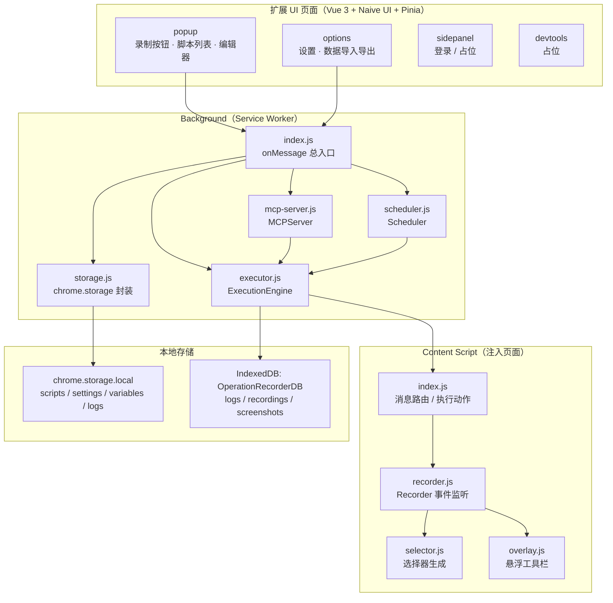
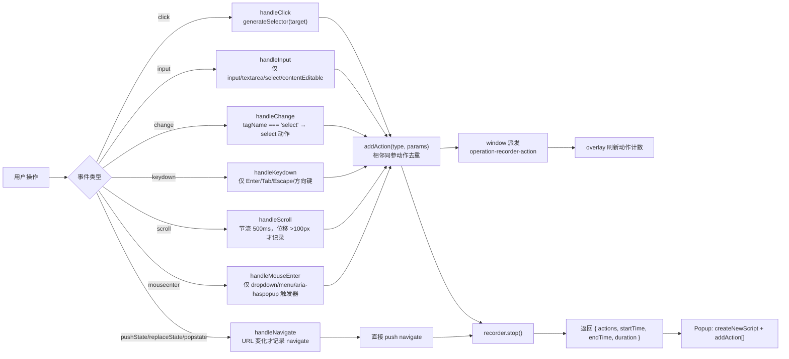
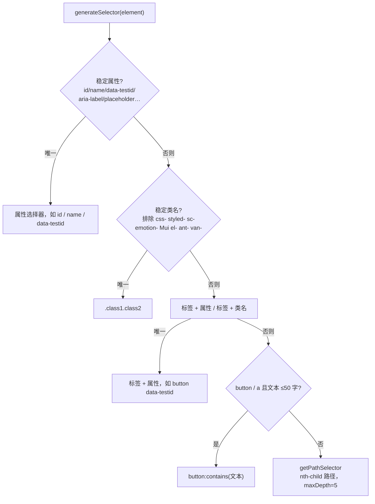
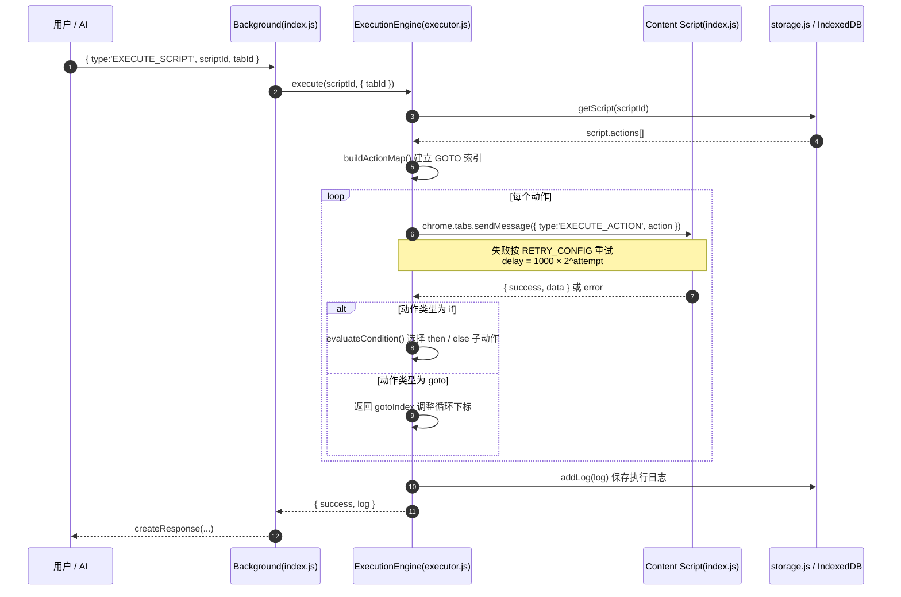
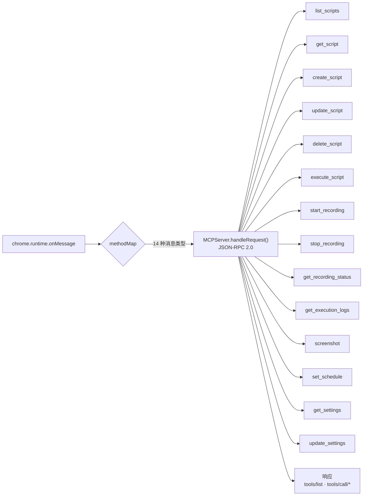
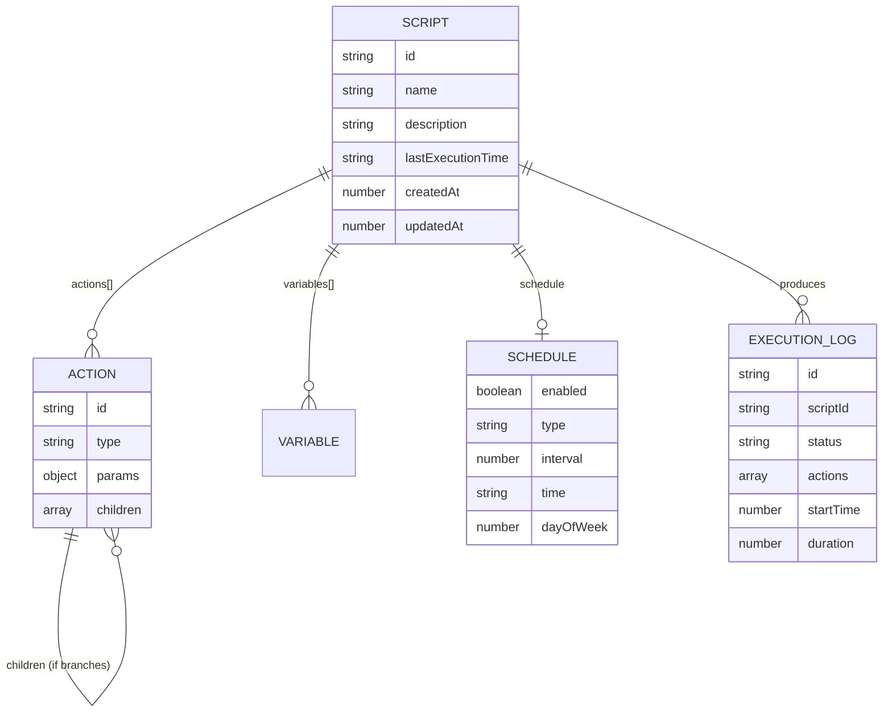

<div align="center">

> [English](./README_en.md) | **简体中文**


# OperationRecorder — 浏览器操作录制器

**把「在网页上重复点几十下」录一次，之后一键重放、定时跑，还能让 AI 替你调。**

录制 → 编排 → 复现 / 定时 / MCP，全部在你本机的 Chrome 扩展里完成。


</div>

---

## 它解决什么问题

日常里大量网页操作是**重复且机械**的：每日签到、后台导出报表、翻页采集、表单重复填报……手工点一次要几十下，明天还得再来一遍。市面上的录制插件要么只能录固定几种动作、要么选择器一改版就失效、要么根本不让你用代码/AI 接管。

**OperationRecorder 把「录一次操作」变成一份可编辑、可重放、可调度的脚本。** 你在页面上正常操作，它把每一次点击、输入、跳转、滚动记成结构化动作；停下来即得脚本，之后可以手动增删排序，也可以交给定时任务或 MCP 协议让 AI 调用。

> 整个工具运行在浏览器扩展沙箱内，脚本与日志存在**你本机的 `chrome.storage` 与 IndexedDB** 里，不依赖任何后端服务（登录模块除外，见下）。

---

## ✨ 功能

- 🎬 **可视化录制**：在页面右下角悬浮工具栏实时显示「动作数 / 时长」，支持暂停、继续、最小化、拖拽；停止后自动落库成脚本。
- 🧠 **智能选择器生成**：优先用 `data-testid` / `id` / `name` / 稳定类名，主动排除 `css-` `styled-` `sc-` `Mui` `el-` `ant-` 等 CSS-in-JS 不稳定类名，最后才回退到带 `:nth-child` 的路径表达式。
- 🧩 **12 种动作类型**：`navigate` `click` `input` `wait` `scroll` `select` `extract` `keypress` `hover` `network` `if` `goto`，覆盖控制流（条件分支、跳转）。
- ✏️ **脚本编辑器**：动作可上移 / 下移 / 删除，脚本可改名、加描述、导出为 JSON。
- ▶️ **执行引擎**：按序重放动作，失败自动重试（指数退避），可选执行前高亮目标元素。
- ⏰ **定时任务**：支持 `interval`（间隔）/ `daily`（每天某时刻）/ `weekly`（每周某天）三种调度，浏览器启动时自动补跑。
- 🤖 **MCP 服务器**：内置 14 个 JSON-RPC 2.0 工具（`list_scripts` / `execute_script` / `start_recording` / `screenshot` / `set_schedule` …），供 AI Agent 调用。
- 💾 **数据导入 / 导出**：一键导出全部脚本、设置、变量为 JSON，亦可导入还原或整体清空。

---

## 🚀 快速开始

### 方式一：面向 AI Agent（一键安装，推荐）

把下面这段提示词直接发给你的本地 AI Agent（Claude Code / Codex / OpenCode …）：

````markdown
请帮我在本机安装并加载 Chrome 扩展 OperationRecorder（GitHub: https://github.com/RayMorTwinkle/OperationRecorder）。
背景：它用于录制、编排并复现浏览器操作，支持定时任务与 MCP。

步骤：
1. 克隆并进入目录：git clone https://github.com/RayMorTwinkle/OperationRecorder.git && cd OperationRecorder
2. 安装依赖：pnpm install（也可用 npm install）
3. 构建产物：pnpm build（会先跑 prettier/lint 再 vite build，输出到 build/）
4. 打开 Chrome：chrome://extensions/ → 开启「开发者模式」→「加载已解压的扩展程序」→ 选择项目下的 build/ 目录
5. 在浏览器工具栏看到 OperationRecorder 图标即安装成功，告知我如何开始录制。
````

### 方式二：面向人类用户

```bash
git clone https://github.com/RayMorTwinkle/OperationRecorder.git
cd OperationRecorder
pnpm install       # 或 npm install
pnpm build         # 产物输出到 build/

# 打开 chrome://extensions/ → 开发者模式 → 加载已解压的扩展 → 选择 build/
```

> **环境要求**：Node.js ≥ 20（`vite@7` 要求 Node 20.19+ / 22.12+，`package.json` 中 `engines` 写的是 `>=14.18.0`，但以 Vite 7 的实际要求为准）、pnpm 或 npm；Chrome / Edge 等 Chromium 内核浏览器。

---

## 🖥️ 使用

### 录制一段操作

```text
1. 打开目标网页
2. 点击工具栏的 OperationRecorder 图标 → 弹出 Popup
3. 点击「录制」按钮，页面右上角出现红色悬浮工具栏
4. 在页面上正常操作（点击 / 输入 / 选择 / 滚动 / 跳转）
5. 点「停止」→ 自动创建名为「录制脚本 <时间>」的脚本
```

### 重放 / 管理脚本

在 Popup 的脚本列表中：

| 图标 | 操作 | 说明 |
|---|---|---|
| ▶ | 执行 | 在当前标签页重放该脚本（`EXECUTE_SCRIPT`） |
| 👁 | 查看 | 打开脚本编辑器，查看动作列表 |
| ✎ | 编辑 | 修改脚本名称 |
| ⬇ | 导出 | 下载脚本 JSON（`<脚本名>.json`） |
| 🗑 | 删除 | 删除脚本 |

### 设置页（`chrome://extensions/` → 详情 → 扩展程序选项）

- **常规设置**：MCP 端口（默认 `9222`）、默认超时（默认 `30000ms`）、最大重试次数（默认 `3`）、自动保存、执行预览。
- **数据管理**：导出全部数据 / 导入数据 / 清空全部数据。

### 让 AI 通过 MCP 调用

扩展内的 `MCPServer` 把内部消息映射为 MCP 工具调用，例如发送 `{ type: 'LIST_SCRIPTS' }` 等价于 `tools/call/list_scripts`。可用工具见[架构](#-架构)一节。工具入参/出参均以 `inputSchema` 声明。

---

## 🏗️ 架构

OperationRecorder 是一个 Manifest V3 扩展，由四类运行上下文组成：**UI 页面**（`render/views`）、**Background Service Worker**（`background/`）、**Content Script**（`contentScript/`）与**存储层**。

### 系统总览



### 录制数据流：从一次点击到一条动作

录制器在**捕获阶段**监听页面事件，经选择器生成后写入 `recordedActions`。



### 选择器生成优先级

`selector.js` 按稳定性从高到低尝试，确保选择器在页面小改动后仍可用。



### 执行时序：重放一段脚本



### MCP 工具路由

`MCPServer` 把扩展内部消息类型映射为 MCP 的 `tools/call/<name>`，由 `handleRequest()` 统一分发。共 **14 个工具**：



> **实现说明（诚实标注）**：当前 `MCPServer` 是一个**进程内分发器**——`handleRequest()` 直接处理来自扩展内部 `chrome.runtime` 的消息，`constructor(port = 9222)` 中的端口号目前**没有**用于真正监听 TCP/WebSocket。设计文档中设想的「WebSocket 桥接 / Native Messaging」属于规划项，尚未落地，因此外部独立进程如何接入 MCP（待确认）。

### 数据模型



---

## 📂 目录结构

```text
OperationRecorder/
├── src/
│   ├── manifest.js                 # 用 @crxjs/vite-plugin 生成的 MV3 manifest
│   ├── background/
│   │   ├── index.js                # Service Worker 入口 / onMessage 总路由
│   │   ├── executor.js             # ExecutionEngine：重放、重试、条件、GOTO
│   │   ├── scheduler.js            # chrome.alarms 定时调度（interval/daily/weekly）
│   │   ├── mcp-server.js           # MCPServer：14 个 MCP 工具 + JSON-RPC 2.0
│   │   ├── storage.js              # chrome.storage.local 封装（脚本/设置/变量/日志）
│   │   └── logger.js               # Background 专用日志
│   ├── contentScript/
│   │   ├── index.js                # 注入入口：消息路由 + 页面内执行动作
│   │   ├── recorder.js             # Recorder：事件监听 → 动作
│   │   ├── selector.js             # 稳定选择器 / XPath 生成
│   │   ├── overlay.js              # 录制悬浮工具栏（可拖拽/最小化）
│   │   └── logger.js               # Content Script 专用日志
│   ├── render/
│   │   ├── views/
│   │   │   ├── popup/              # 主界面：录制控制 + 脚本列表 + 编辑器
│   │   │   ├── options/            # 设置页：常规 / 数据管理 / 关于
│   │   │   ├── sidepanel/          # 侧边栏（模板占位 + 登录）
│   │   │   ├── devtools/           # DevTools 面板（模板占位）
│   │   │   └── newtab/             # 新标签页（模板占位）
│   │   ├── components/
│   │   │   ├── ScriptEditor.vue    # 动作列表编辑（上下移 / 删除）
│   │   │   └── login/              # 可选的登录鉴权模块
│   │   ├── store/                  # Pinia：scripts / recording / settings
│   │   ├── types/                  # actions.js（动作/设置/常量）· messages.js（消息）
│   │   └── utils/idb.js            # IndexedDB 封装（logs/recordings/screenshots）
│   └── zip.js                      # gulp-zip 打包脚本
├── scripts/
│   ├── build-crx.js                # crx3 打包 .crx / .zip / update.xml
│   └── generate-logos.js           # 由 logo.png 生成多尺寸图标
├── public/icons/logo.svg           # 图标（README 头图引用 assets/logo.svg）
├── md/                             # 补充文档（crx 打包、登录接入等）
├── .trae/documents/                # 实施计划与开发记录
├── vite.config.js                  # Vite + crx + Vue + UnoCSS + 自动导入
├── uno.config.js                   # UnoCSS 配置
└── package.json
```

---

## 🔧 技术细节

**Manifest V3 与权限**（`src/manifest.js`）。扩展申请了 `sidePanel` `storage` `cookies` `notifications` `tabs` `clipboardWrite` `clipboardRead` `scripting` `contentSettings` `downloads` `background` `alarms` `desktopCapture` `declarativeNetRequest` `debugger` `history` `activeTab`；Content Script 默认匹配 `http://*/*`、`https://*/*`、`file://*/*`。

**存储键与配额**。脚本、设置、变量、日志都走 `chrome.storage.local`：

| 键 | 内容 | 边界处理 |
|---|---|---|
| `scripts` | `{ [id]: Script }` | 保存时自动刷新 `updatedAt` |
| `settings` | 用户设置 | 读取时与 `DEFAULT_SETTINGS` 合并 |
| `variables` | 全局变量 | 按名增删 |
| `logs` | 执行日志数组 | **仅保留最近 1000 条**，超出从头截断 |

**IndexedDB**：`OperationRecorderDB`（版本 1），对象仓库 `logs`（索引 `scriptId`/`startTime`/`status`）、`recordings`（索引 `tabId`/`timestamp`）、`screenshots`（索引 `scriptId`/`timestamp`），用于承载大体积的执行日志与截图。

**默认设置**（`DEFAULT_SETTINGS`）：`mcpPort: 9222`、`defaultTimeout: 30000`、`maxRetries: 3`、`theme: 'auto'`、`autoSave: true`、`showExecutionPreview: true`。

**重试与退避**（`RETRY_CONFIG`）：`maxRetries: 3`、`retryDelay: 1000ms`、`backoffMultiplier: 2`，即第 n 次重试等待 `1000 × 2^n` 毫秒。

**页面加载等待**（`waitForTabLoad`）：监听 `chrome.tabs.onUpdated` 的 `status === 'complete'`，再额外等待 **500ms** 确保脚本就绪；最长等待 **30s** 后放行。

**导航监听**：`recorder.js` 通过**改写** `history.pushState` / `history.replaceState` 并监听 `popstate` 捕获 SPA 路由跳转，`stop()` 时把原始方法还原。

**动作去重**：`addAction` 会比较「最后一个动作」的类型与全部 `params`，完全相同则只更新时间戳而不新增，避免连续同类事件刷屏。

**条件与跳转**：`if` 动作通过 `evaluateCondition()` 支持 `element_exists` / `element_not_exists` / `page_contains` / `variable_equals` / `variable_contains`；`goto` 通过执行前构建的 `actionMap`（`action.id → index`）返回 `gotoIndex` 调整主循环下标，因而**只支持跳转到同层动作**（`parentId` 记录了层级，但 `goto` 取的是 `actionMap` 中的 `index`）。

**构建与打包**：

| 命令 | 作用 |
|---|---|
| `pnpm dev` | Vite 开发服务（`localhost:5173`） |
| `pnpm build` | `pnpm format` → `vite build`，输出 `build/` |
| `pnpm zip` | 构建后用 `gulp-zip` 打包到 `package/*.zip` |
| `pnpm crx` | 构建后用 `crx3` 生成 `.crx` / `.zip` / `update.xml`（密钥 `private.pem`） |
| `pnpm pack` | 同时产出 zip 与 crx |
| `pnpm generate-logos` | 由 `public/logo.png` 生成多尺寸图标 |

> `.gitignore` 已忽略 `build/`、`package/`、`keys/`、`private.pem`，因此构建产物与签名私钥不会入库。

**登录模块**（可选，`src/render/components/login/auth.js`）：`LOGIN_ENABLED = import.meta.env.MODE !== 'development'`，即**开发模式自动关闭**；生产模式下用 `userId + userSecret` 请求云端 API Key 校验接口，设备指纹 `deviceId = chrome.runtime.id + randomUUID()`，登录态写入 `chrome.storage.sync` 的 `user` 键，Token 有效期 **7 天**，并通过名为 `autoVerifyLogin` 的 alarm **每 60 分钟**自动复验一次。

**日志系统**（`src/utils/logger.js`）：基于 `loglevel`，自动识别运行上下文（background / contentScript / popup / options / sidepanel / devtools / newtab），带彩色时间戳前缀；可选持久化到 `chrome.storage.local`（同样保留最近 1000 条）。

---

## ❓ 常见问题

**Q：开始录制时提示 "Receiving end does not exist"，怎么办？**
A：说明当前页面还没注入 Content Script（常见于打开扩展后未刷新的旧标签页）。**刷新页面后重试**即可，Popup 中也已针对该错误给出提示。

**Q：支持哪些页面？`chrome://` 或本地文件能录吗？**
A：Content Script 匹配 `http://*/*`、`https://*/*`、`file://*/*`。浏览器内部页面（`chrome://`、扩展商店页等）受浏览器限制无法注入，因此不能录制。

**Q：脚本存在哪？换电脑会丢吗？**
A：存在 `chrome.storage.local` + IndexedDB，属于当前浏览器配置文件。换设备可用设置页的「导出所有数据」下载 JSON，再在新设备「导入数据」。

**Q：`file://` 页面录制后执行失败？**
A：Chrome 默认禁止扩展访问本地文件，需要在 `chrome://extensions/` 中为该扩展开启「允许访问文件网址」。

**Q：定时任务需要浏览器一直开着吗？**
A：是的。调度依赖 `chrome.alarms`（每分钟检查一次）与 `onStartup`，浏览器关闭期间不会执行；重新启动时会检测到期任务并补跑。

**Q：MCP 端口 `9222` 怎么被外部程序连上？**
A：见[架构](#-架构)中的实现说明——当前 MCP 是扩展内部的 JSON-RPC 分发器，端口字段尚未用于真实网络监听，外部接入方式（待确认）。

---

## ⚠️ 注意事项

- **执行会真实操作你的浏览器**：脚本按录制内容重放点击/输入，请在可控页面里测试。执行中的**暂停 / 恢复 / 停止**能力已实现于执行引擎，但 Popup 未暴露全部控制按钮（待确认）。
- **选择器会随页面改版失效**：录制时选择器尽量稳定，但目标站点结构大改后仍需手动修正。
- **隐私**：录制内容可能包含账号、表单等敏感信息，导出的 JSON 请妥善保管，勿上传公开位置；本工具不上传任何数据（登录模块仅发送你所填的 `userId / userSecret` 做校验）。
- **登录模块的云端接口为原作者项目内置**（CloudBase 函数），如不使用可直接忽略；该接口的可用性由作者维护，与本仓库（待确认）。

---

## 📄 License

本项目采用 **MIT License**（见 [LICENSE](./LICENSE)）。Copyright (c) 2025-present。

---

## 🙏 致谢 / Credits

- 本项目基于 **[BluerAngala/template-chrome-crx-vue-js](https://gitcode.com/BluerAngala/template-chrome-crx-vue-js)**（Vue 3 + Vite + UnoCSS 的 Chrome 扩展模板）二次开发，作者 **BluerAngala**。原模板提供了 Popup / Options / SidePanel / DevTools / NewTab 的多入口脚手架、`webextension-polyfill` 与统一日志系统。
- 在模板基础上新增了录制器（`recorder.js` / `selector.js` / `overlay.js`）、执行引擎（`executor.js`）、定时调度（`scheduler.js`）、MCP 服务器（`mcp-server.js`）以及脚本管理与数据导入导出。
- 图标、README（中英双语）为本项目整理；技术栈感谢 [Vue 3](https://vuejs.org/)、[Vite](https://vitejs.dev/)、[Naive UI](https://www.naiveui.com/)、[UnoCSS](https://unocss.dev/)、[Pinia](https://pinia.vuejs.org/) 与 [@crxjs/vite-plugin](https://crxjs.dev/)。

---

<div align="center">
<sub>OperationRecorder · 录一次，重复的事就交给它</sub>
</div>
