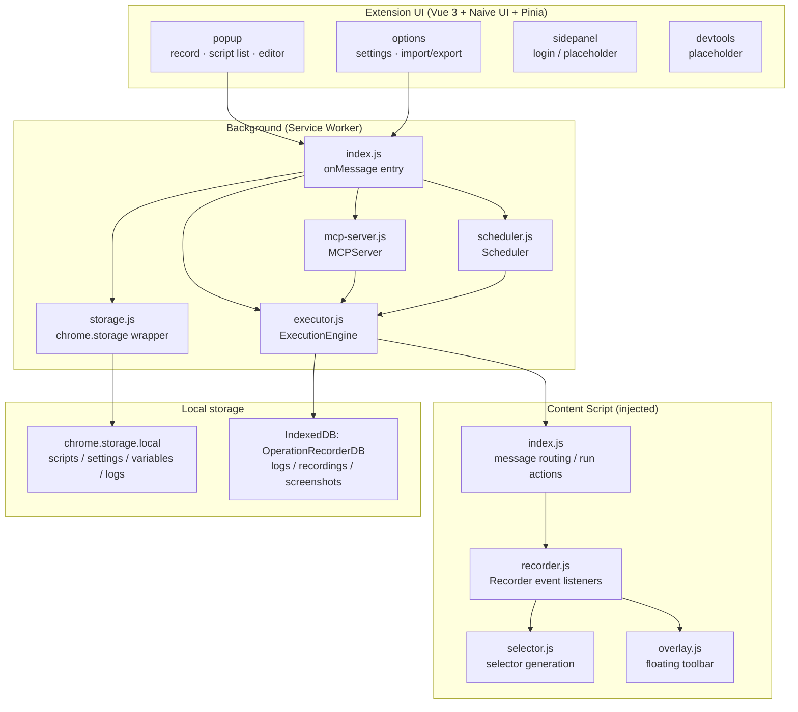
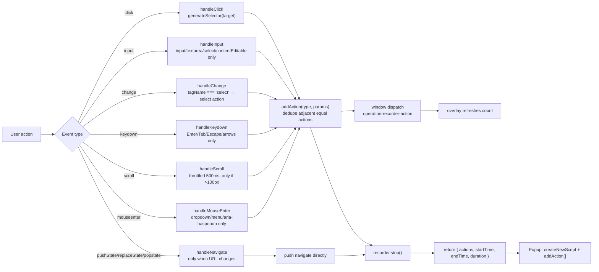
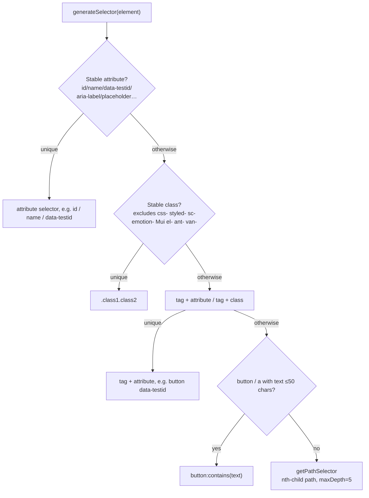
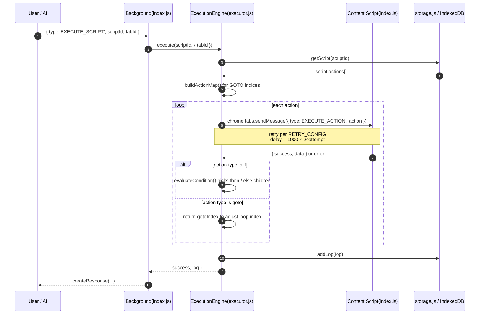
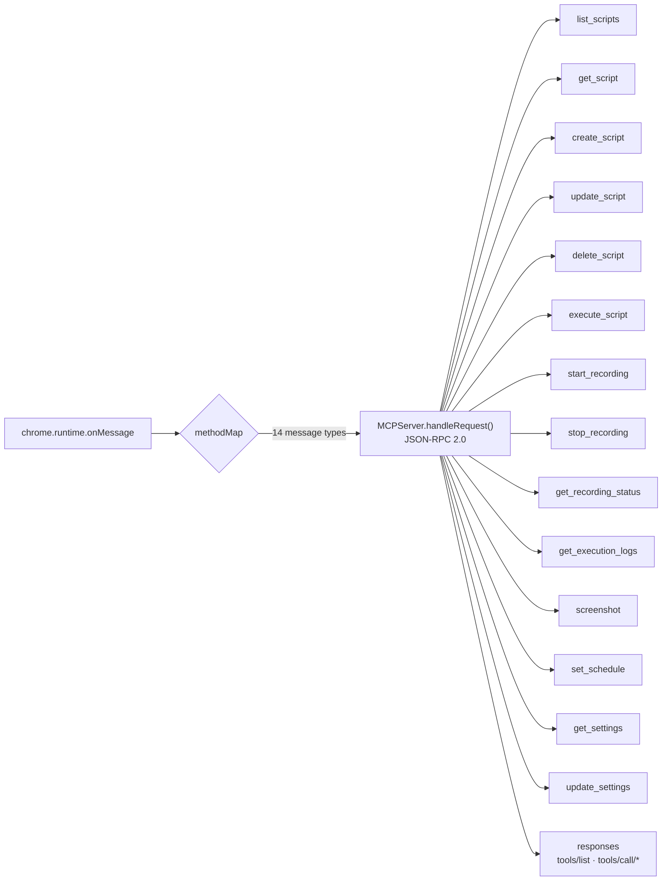
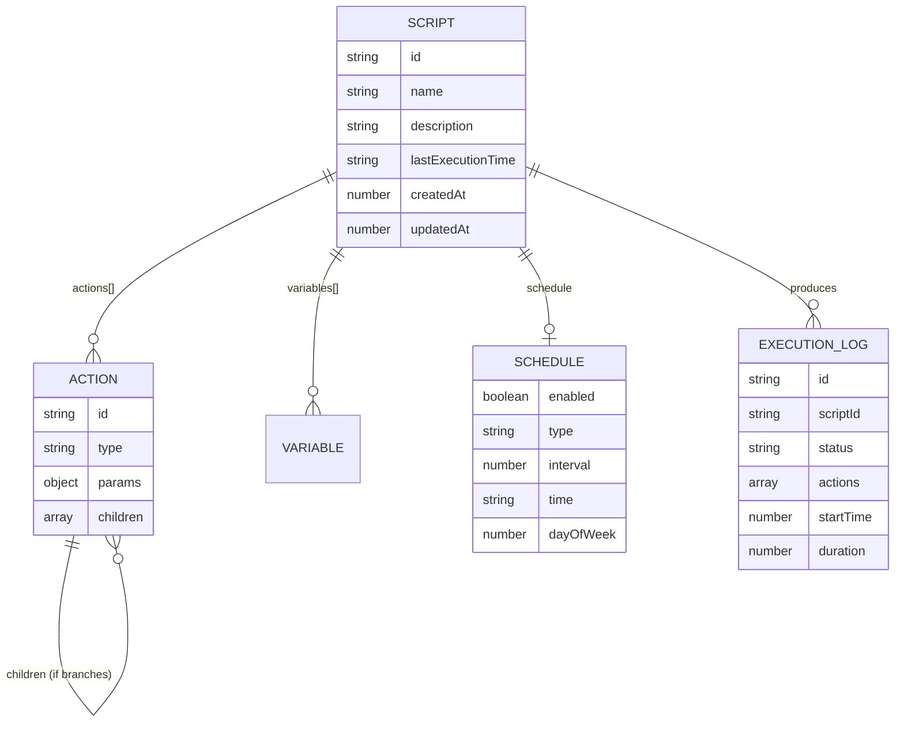

<div align="center">

> **English** | [简体中文](./README.md)


# OperationRecorder — Browser Action Recorder

**Record a repetitive web workflow once, then replay it on demand, on a schedule, or hand it to AI via MCP.**

Record → edit → replay / schedule / MCP — all inside a local Chrome extension.


</div>

---

## Why it exists

A huge amount of everyday web work is **repetitive and mechanical**: daily check-ins, exporting the same report, paginating through lists, re-filling the same forms. One manual pass can take dozens of clicks — and you do it all again tomorrow. Existing recorder extensions either capture only a few action types, break the moment the page markup changes, or give you no way to drive them from code or AI.

**OperationRecorder turns "do it once" into an editable, replayable, schedulable script.** You operate the page normally; it records every click, input, navigation and scroll as a structured action. Stop recording and you get a script you can reorder, edit, export — or run from a scheduler, or expose to an AI through MCP.

> Everything runs inside the extension sandbox. Scripts and logs live in **your local `chrome.storage` and IndexedDB** — no backend service is required (except for the optional login module; see below).

---

## ✨ Features

- 🎬 **Visual recording** — a floating toolbar shows live action count and duration; it can be paused, resumed, minimized and dragged. Stopping auto-saves a script.
- 🧠 **Smart selector generation** — prefers `data-testid` / `id` / `name` / stable class names, deliberately excludes unstable CSS-in-JS classes (`css-`, `styled-`, `sc-`, `Mui`, `el-`, `ant-`, …), and only falls back to an `:nth-child` path as a last resort.
- 🧩 **12 action types** — `navigate` `click` `input` `wait` `scroll` `select` `extract` `keypress` `hover` `network` `if` `goto`, including control flow (conditionals, jumps).
- ✏️ **Script editor** — move actions up/down, delete them, rename the script, add a description, export as JSON.
- ▶️ **Execution engine** — replays actions in order, retries failures with exponential backoff, and can highlight the target element before acting.
- ⏰ **Scheduled tasks** — `interval`, `daily` (at a time) and `weekly` (on a weekday); expired tasks are caught up on browser startup.
- 🤖 **MCP server** — 14 JSON-RPC 2.0 tools (`list_scripts` / `execute_script` / `start_recording` / `screenshot` / `set_schedule`, …) for AI agents.
- 💾 **Import / export** — dump every script, setting and variable to JSON, import it back, or wipe everything.

---

## 🚀 Quick Start

### Option 1 — For AI agents (one-shot install, recommended)

Paste this prompt into your local AI agent (Claude Code / Codex / OpenCode …):

````markdown
Please install and load the Chrome extension OperationRecorder on my machine (GitHub: https://github.com/RayMorTwinkle/OperationRecorder).
Context: it records, edits and replays browser actions, with scheduling and MCP support.

Steps:
1. Clone and enter: git clone https://github.com/RayMorTwinkle/OperationRecorder.git && cd OperationRecorder
2. Install deps: pnpm install (or npm install)
3. Build: pnpm build (runs prettier/lint then vite build, output goes to build/)
4. In Chrome: open chrome://extensions/ → enable "Developer mode" → "Load unpacked" → select the build/ directory
5. Once the OperationRecorder icon appears in the toolbar, tell me how to start recording.
````

### Option 2 — For humans

```bash
git clone https://github.com/RayMorTwinkle/OperationRecorder.git
cd OperationRecorder
pnpm install       # or npm install
pnpm build         # output goes to build/

# Open chrome://extensions/ → Developer mode → Load unpacked → select build/
```

> **Requirements**: Node.js ≥ 20 (`vite@7` needs Node 20.19+ / 22.12+; `package.json` declares `engines: >=14.18.0`, but Vite 7's actual requirement wins), pnpm or npm, and a Chromium-based browser (Chrome / Edge).

---

## 🖥️ Usage

### Record a workflow

```text
1. Open the target page
2. Click the OperationRecorder icon in the toolbar → the Popup opens
3. Click "录制 / Record"; a red floating toolbar appears at the top-right
4. Operate the page normally (click / type / select / scroll / navigate)
5. Click "停止 / Stop" → a script named "录制脚本 <timestamp>" is created
```

### Replay / manage scripts

In the Popup script list:

| Icon | Action | Notes |
|---|---|---|
| ▶ | Run | Replay in the current tab (`EXECUTE_SCRIPT`) |
| 👁 | View | Open the editor and inspect actions |
| ✎ | Edit | Rename the script |
| ⬇ | Export | Download the script JSON (`<name>.json`) |
| 🗑 | Delete | Remove the script |

### Options page (`chrome://extensions/` → Details → Extension options)

- **General**: MCP port (default `9222`), default timeout (default `30000ms`), max retries (default `3`), auto-save, execution preview.
- **Data management**: export all data / import data / clear all data.

### Driving it from AI via MCP

The in-extension `MCPServer` maps internal messages to MCP tool calls, e.g. sending `{ type: 'LIST_SCRIPTS' }` is equivalent to `tools/call/list_scripts`. See [Architecture](#️-architecture) for the full tool list; inputs/outputs are declared via `inputSchema`.

---

## 🏗️ Architecture

OperationRecorder is a Manifest V3 extension with four runtime contexts: **UI pages** (`render/views`), the **Background Service Worker** (`background/`), the **Content Script** (`contentScript/`), and the **storage layer**.

### System overview



### Recording data flow: from a click to an action

The recorder listens in the **capture phase** and, after generating a selector, appends to `recordedActions`.



### Selector generation priority

`selector.js` tries from most to least stable, so selectors survive minor page changes.



### Execution sequence: replaying a script



### MCP tool routing

`MCPServer` maps internal message types to MCP `tools/call/<name>`, dispatched by `handleRequest()`. There are **14 tools**:



> **Implementation note (stated honestly)**: `MCPServer` is currently an **in-process dispatcher** — `handleRequest()` directly handles `chrome.runtime` messages from within the extension, and the `constructor(port = 9222)` value is **not** used to listen on a real TCP/WebSocket port. The "WebSocket bridge / Native Messaging" idea in the design doc is planned but unimplemented, so how an external process connects over MCP is (to be confirmed).

### Data model



---

## 📂 Project layout

```text
OperationRecorder/
├── src/
│   ├── manifest.js                 # MV3 manifest generated via @crxjs/vite-plugin
│   ├── background/
│   │   ├── index.js                # Service worker entry / onMessage router
│   │   ├── executor.js             # ExecutionEngine: replay, retry, conditions, GOTO
│   │   ├── scheduler.js            # chrome.alarms scheduler (interval/daily/weekly)
│   │   ├── mcp-server.js           # MCPServer: 14 MCP tools + JSON-RPC 2.0
│   │   ├── storage.js              # chrome.storage.local wrapper (scripts/settings/vars/logs)
│   │   └── logger.js               # Background logger
│   ├── contentScript/
│   │   ├── index.js                # Injection entry: message routing + in-page actions
│   │   ├── recorder.js             # Recorder: DOM events → actions
│   │   ├── selector.js             # Stable selector / XPath generation
│   │   ├── overlay.js              # Recording toolbar (draggable/minimizable)
│   │   └── logger.js               # Content-script logger
│   ├── render/
│   │   ├── views/
│   │   │   ├── popup/              # Main UI: recording control + script list + editor
│   │   │   ├── options/            # Settings: general / data / about
│   │   │   ├── sidepanel/          # Side panel (template placeholder + login)
│   │   │   ├── devtools/           # DevTools panel (template placeholder)
│   │   │   └── newtab/             # New tab (template placeholder)
│   │   ├── components/
│   │   │   ├── ScriptEditor.vue    # Action list editing (move up/down, delete)
│   │   │   └── login/              # Optional auth module
│   │   ├── store/                  # Pinia: scripts / recording / settings
│   │   ├── types/                  # actions.js (actions/settings) · messages.js
│   │   └── utils/idb.js            # IndexedDB wrapper (logs/recordings/screenshots)
│   └── zip.js                      # gulp-zip packaging
├── scripts/
│   ├── build-crx.js                # crx3 packaging: .crx / .zip / update.xml
│   └── generate-logos.js           # Generate icon sizes from logo.png
├── public/icons/logo.svg           # Icon (README header references assets/logo.svg)
├── md/                             # Extra docs (crx packaging, login integration)
├── .trae/documents/                # Implementation plan and dev notes
├── vite.config.js                  # Vite + crx + Vue + UnoCSS + auto-import
├── uno.config.js                   # UnoCSS config
└── package.json
```

---

## 🔧 Technical notes

**Manifest V3 and permissions** (`src/manifest.js`): the extension requests `sidePanel`, `storage`, `cookies`, `notifications`, `tabs`, `clipboardWrite`, `clipboardRead`, `scripting`, `contentSettings`, `downloads`, `background`, `alarms`, `desktopCapture`, `declarativeNetRequest`, `debugger`, `history`, `activeTab`. The content script matches `http://*/*`, `https://*/*`, `file://*/*`.

**Storage keys and quotas** — scripts, settings, variables and logs all live in `chrome.storage.local`:

| Key | Contents | Boundary handling |
|---|---|---|
| `scripts` | `{ [id]: Script }` | `updatedAt` refreshed on save |
| `settings` | user settings | merged with `DEFAULT_SETTINGS` on read |
| `variables` | global variables | add/remove by name |
| `logs` | execution log array | **keeps only the latest 1000** entries, trimmed from the front |

**IndexedDB**: `OperationRecorderDB` (version 1) with object stores `logs` (indices `scriptId`/`startTime`/`status`), `recordings` (indices `tabId`/`timestamp`) and `screenshots` (indices `scriptId`/`timestamp`), used for bulky execution logs and screenshots.

**Default settings** (`DEFAULT_SETTINGS`): `mcpPort: 9222`, `defaultTimeout: 30000`, `maxRetries: 3`, `theme: 'auto'`, `autoSave: true`, `showExecutionPreview: true`.

**Retry and backoff** (`RETRY_CONFIG`): `maxRetries: 3`, `retryDelay: 1000ms`, `backoffMultiplier: 2` — i.e. the n-th retry waits `1000 × 2^n` ms.

**Page-load wait** (`waitForTabLoad`): listens for `chrome.tabs.onUpdated` with `status === 'complete'`, then waits an extra **500ms** for scripts to settle; it gives up after at most **30s**.

**Navigation tracking**: `recorder.js` **monkey-patches** `history.pushState` / `history.replaceState` and listens to `popstate` to catch SPA route changes, restoring the originals in `stop()`.

**Action deduplication**: `addAction` compares the last action's type and all `params`; identical ones only refresh the timestamp instead of adding a new entry.

**Conditions and jumps**: `if` actions use `evaluateCondition()` with `element_exists` / `element_not_exists` / `page_contains` / `variable_equals` / `variable_contains`; `goto` returns a `gotoIndex` from a prebuilt `actionMap` (`action.id → index`) to adjust the main loop. It therefore **only jumps among siblings** (the `parentId` records nesting, but `goto` uses the `index` in `actionMap`).

**Build and packaging**:

| Command | Purpose |
|---|---|
| `pnpm dev` | Vite dev server (`localhost:5173`) |
| `pnpm build` | `pnpm format` → `vite build`, output to `build/` |
| `pnpm zip` | Build then package to `package/*.zip` via `gulp-zip` |
| `pnpm crx` | Build then generate `.crx` / `.zip` / `update.xml` via `crx3` (key `private.pem`) |
| `pnpm pack` | Produce both zip and crx |
| `pnpm generate-logos` | Generate icon sizes from `public/logo.png` |

> `.gitignore` excludes `build/`, `package/`, `keys/` and `private.pem`, so build artifacts and the signing key never enter the repo.

**Login module** (optional, `src/render/components/login/auth.js`): `LOGIN_ENABLED = import.meta.env.MODE !== 'development'`, i.e. **disabled automatically in development**. In production it verifies an API key against a cloud endpoint using `userId + userSecret`; the device fingerprint is `deviceId = chrome.runtime.id + randomUUID()`, the session is stored under the `user` key in `chrome.storage.sync`, the token lasts **7 days**, and a `autoVerifyLogin` alarm re-verifies it **every 60 minutes**.

**Logging** (`src/utils/logger.js`): built on `loglevel`, auto-detects the runtime context (background / contentScript / popup / options / sidepanel / devtools / newtab) and prints colored, timestamped prefixes; optional persistence to `chrome.storage.local` (also capped at 1000 entries).

---

## ❓ FAQ

**Q: Recording fails with "Receiving end does not exist". What now?**
A: The current page has no content script injected yet — common on tabs opened before the extension loaded. **Refresh the page** and retry; the Popup already surfaces this hint.

**Q: Which pages are supported? Can I record `chrome://` or local files?**
A: The content script matches `http://*/*`, `https://*/*`, `file://*/*`. Browser-internal pages (`chrome://`, the Web Store, etc.) cannot be injected and thus cannot be recorded.

**Q: Where are scripts stored? Will they survive a machine change?**
A: In `chrome.storage.local` + IndexedDB, tied to the current browser profile. To move, use the options page's "Export all data" to download JSON, then "Import data" on the new machine.

**Q: Recording a `file://` page works, but replay fails?**
A: Chrome blocks extension access to local files by default. Enable "Allow access to file URLs" for the extension in `chrome://extensions/`.

**Q: Does a scheduled task require the browser to stay open?**
A: Yes. Scheduling relies on `chrome.alarms` (checked once a minute) plus `onStartup`; it does not run while the browser is closed, but due tasks are caught up on the next startup.

**Q: How does an external program connect to MCP port `9222`?**
A: See the implementation note under [Architecture](#️-architecture) — the current MCP is an in-extension JSON-RPC dispatcher, the port field is not yet used for a real network listener, and the external access path is (to be confirmed).

---

## ⚠️ Notes

- **Execution really drives your browser**: scripts replay clicks and typing as recorded — test on pages you control. Pause / resume / stop exist in the execution engine, but the Popup does not yet expose every control (to be confirmed).
- **Selectors can break on site redesigns**: selectors are kept stable where possible, but a major markup change may still require manual fixes.
- **Privacy**: recordings may capture credentials and form values; keep exported JSON safe and never upload it publicly. The tool uploads nothing (the login module only sends the `userId / userSecret` you enter for verification).
- **The login module's cloud endpoint is built into the original author's project** (a CloudBase function). Ignore it if unused; its availability is maintained by the author and is (to be confirmed) with respect to this repository.

---

## 📄 License

Released under the **MIT License** (see [LICENSE](./LICENSE)). Copyright (c) 2025-present.

---

## 🙏 Credits

- Built on **[BluerAngala/template-chrome-crx-vue-js](https://gitcode.com/BluerAngala/template-chrome-crx-vue-js)** (a Vue 3 + Vite + UnoCSS Chrome extension template) by **BluerAngala**. The template provided the multi-entry scaffolding (Popup / Options / SidePanel / DevTools / NewTab), `webextension-polyfill` and the unified logging system.
- Added on top of the template: the recorder (`recorder.js` / `selector.js` / `overlay.js`), execution engine (`executor.js`), scheduler (`scheduler.js`), MCP server (`mcp-server.js`), plus script management and data import/export.
- The icon and this bilingual README were produced for this project. Thanks to [Vue 3](https://vuejs.org/), [Vite](https://vitejs.dev/), [Naive UI](https://www.naiveui.com/), [UnoCSS](https://unocss.dev/), [Pinia](https://pinia.vuejs.org/) and [@crxjs/vite-plugin](https://crxjs.dev/).

---

<div align="center">
<sub>OperationRecorder · Record once, let it handle the rest</sub>
</div>
